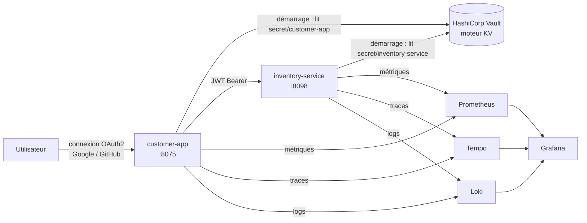

<p align="right"><a href="README.md">EN</a> | <b>FR</b></p>

# Microservices Spring avec HashiCorp Vault

Externalisation des secrets de microservices Spring Boot dans HashiCorp Vault : aucun identifiant dans le code ni dans les fichiers de configuration, ils sont récupérés depuis Vault au démarrage. La stack est déployée avec Docker Compose via un pipeline Jenkins et supervisée avec Prometheus, Loki, Tempo et Grafana.


## Architecture



| Composant | Rôle |
|---|---|
| **customer-app** | Application web Thymeleaf, client OAuth2 (Google, GitHub). Ses identifiants clients et secrets sont stockés dans Vault. |
| **inventory-service** | API REST sécurisée en resource server OAuth2 ; sa configuration provient aussi de Vault. |
| **Vault** | Stocke les secrets de chaque service sous `secret/<nom-application>`. |
| **Observabilité** | Prometheus (métriques), Tempo (traces), Loki (logs), cAdvisor (conteneurs) et Grafana avec sources de données liées : on passe d'une ligne de log à la trace correspondante, et inversement. |

## Chargement des secrets

Chaque service utilise `spring-cloud-starter-vault-config`. Au démarrage, il s'authentifie auprès de Vault avec le token fourni dans `VAULT_TOKEN`, lit le chemin KV portant le nom de l'application et injecte les valeurs comme des propriétés Spring classiques.

```text
secret/customer-app
├── spring.security.oauth2.client.registration.google.clientId
├── spring.security.oauth2.client.registration.google.client-secret
├── spring.security.oauth2.client.registration.github.clientId
└── spring.security.oauth2.client.registration.github.client-secret
```

Le code et `application.properties` ne contiennent aucun secret : changer un identifiant revient à mettre à jour Vault et redémarrer le service.

## CI/CD

Le [jenkinsfile](jenkinsfile) récupère le dépôt et redéploie toute la stack avec `docker compose up --build`. L'adresse et le token Vault proviennent des credentials Jenkins (`vault-addr`, `vault-token`), jamais du dépôt.

## Démarrage

1. Lancer Vault et écrire les secrets :

   ```bash
   docker network create vault_network
   docker run -d --name vault --network vault_network -p 8200:8200 \
     -e VAULT_DEV_ROOT_TOKEN_ID=<token> hashicorp/vault

   export VAULT_ADDR=http://localhost:8200 VAULT_TOKEN=<token>
   vault kv put secret/customer-app \
     spring.security.oauth2.client.registration.google.clientId=... \
     spring.security.oauth2.client.registration.google.client-secret=... \
     spring.security.oauth2.client.registration.github.clientId=... \
     spring.security.oauth2.client.registration.github.client-secret=...
   ```

2. Lancer la stack :

   ```bash
   export VAULT_TOKEN=<token> GRAFANA_ADMIN_PASSWORD=<mot-de-passe>
   docker compose up --build -d
   ```

| Service | URL |
|---|---|
| customer-app | http://localhost:8075 |
| inventory-service | http://localhost:8098 |
| Grafana | http://localhost:3000 |
| Prometheus | http://localhost:9090 |
| cAdvisor | http://localhost:8070 |
