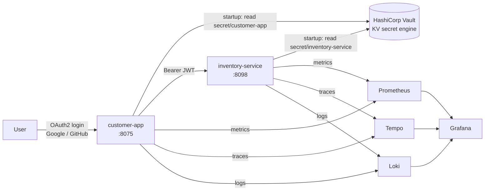

<p align="right"><b>EN</b> | <a href="README.fr.md">FR</a></p>

# Spring Microservices with HashiCorp Vault

Externalizing the secrets of Spring Boot microservices into HashiCorp Vault: no credentials in the code or in configuration files, they are fetched from Vault at startup. The stack is deployed with Docker Compose through a Jenkins pipeline and monitored with Prometheus, Loki, Tempo and Grafana.


## Architecture



| Component | Role |
|---|---|
| **customer-app** | Thymeleaf web app, OAuth2 client (Google, GitHub). Its client IDs and secrets live in Vault. |
| **inventory-service** | REST API secured as an OAuth2 resource server; its configuration also comes from Vault. |
| **Vault** | Stores each service's secrets under `secret/<application-name>`. |
| **Observability** | Prometheus (metrics), Tempo (traces), Loki (logs), cAdvisor (containers) and Grafana with linked data sources: a trace can be opened from a log line and the other way around. |

## How secrets are loaded

Each service uses `spring-cloud-starter-vault-config`. At startup, it authenticates to Vault with the token passed in `VAULT_TOKEN`, reads the KV path named after the application, and injects the values as regular Spring properties.

```text
secret/customer-app
├── spring.security.oauth2.client.registration.google.clientId
├── spring.security.oauth2.client.registration.google.client-secret
├── spring.security.oauth2.client.registration.github.clientId
└── spring.security.oauth2.client.registration.github.client-secret
```

The code and `application.properties` contain no secret: changing a credential only requires updating Vault and restarting the service.

## CI/CD

The [jenkinsfile](jenkinsfile) checks out the repository and redeploys the whole stack with `docker compose up --build`. The Vault address and token come from Jenkins credentials (`vault-addr`, `vault-token`), never from the repository.

## Getting started

1. Start Vault and write the secrets:

   ```bash
   docker network create vault_network
   docker run -d --name vault --network vault_network -p 8200:8200 \
     -e VAULT_DEV_ROOT_TOKEN_ID=<token> hashicorp/vault

   export VAULT_ADDR=http://localhost:8200 VAULT_TOKEN=<token>
   vault kv put secret/customer-app \
     spring.security.oauth2.client.registration.google.clientId=... \
     spring.security.oauth2.client.registration.google.client-secret=... \
     spring.security.oauth2.client.registration.github.clientId=... \
     spring.security.oauth2.client.registration.github.client-secret=...
   ```

2. Start the stack:

   ```bash
   export VAULT_TOKEN=<token> GRAFANA_ADMIN_PASSWORD=<password>
   docker compose up --build -d
   ```

| Service | URL |
|---|---|
| customer-app | http://localhost:8075 |
| inventory-service | http://localhost:8098 |
| Grafana | http://localhost:3000 |
| Prometheus | http://localhost:9090 |
| cAdvisor | http://localhost:8070 |
